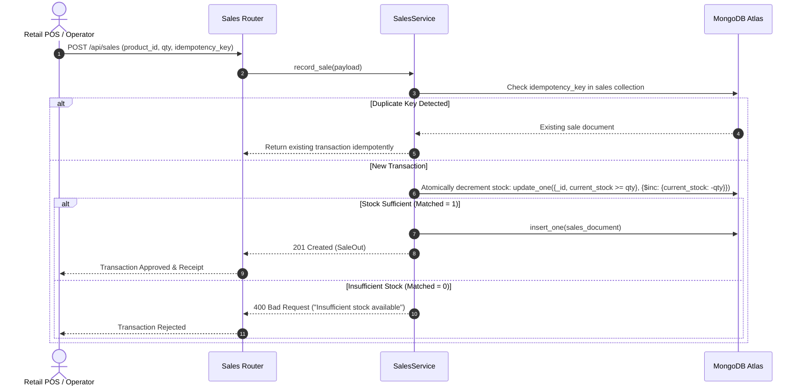

# System Architecture

## 1. High-Level Architecture Overview

The Intelligent Inventory & Demand Forecasting System is designed with a clean, decoupled three-tier architecture utilizing Python as the unified backend runtime.

```mermaid
flowchart TD
    subgraph Client ["Client Tier (React + Vite + TypeScript)"]
        UI["SPA Web Application"]
        Router["React Router v6"]
        Charts["Recharts Visualizations"]
        State["SystemContext & API Client"]
    end

    subgraph API ["Application Tier (FastAPI 3.12+)"]
        Main["FastAPI ASGI App (Uvicorn)"]
        Routers["REST API Routers (/api/*)"]
        Services["Service Layer (Domain Logic)"]
        ML["scikit-learn Forecasting Engine"]
        PyMongo["PyMongo Singleton Connection Pool"]
    end

    subgraph Database ["Persistence Tier (MongoDB Atlas)"]
        Collections["Collections: products, sales, suppliers, purchase_orders, forecasts, settings"]
        Validators["$jsonSchema Collection Validators"]
        Indexes["B-Tree Indexes (Unique, Compound, Text)"]
    end

    UI --> Router
    Router --> State
    State --> Charts
    State -->|HTTP / JSON (REST)| Main
    Main --> Routers
    Routers --> Services
    Services --> ML
    Services --> PyMongo
    PyMongo -->|Connection Pool| Database
```

## 2. Component Design

### 2.1 Frontend Client (`frontend/`)
- **Framework:** React 18 with Vite and TypeScript.
- **Styling:** Tailwind CSS using an editorial, restrained design system (Slate / Zinc neutral palette, high-contrast status badges).
- **Visualizations:** Recharts for time-series demand projections, historical actuals, confidence intervals, and category sales shares.
- **State & Networking:** `SystemContext` manages connectivity state, live vs. demo mode indicators, and global notification toasts. The typed `ApiClient` layer interfaces with the REST API and provides graceful fallback to labeled demo data if the backend is waking from a cold start.

### 2.2 Backend REST API (`backend/`)
- **Framework:** FastAPI with Python 3.12+ running on Uvicorn ASGI.
- **Validation:** Pydantic v2 schemas for all incoming request bodies and outgoing responses.
- **Persistence Driver:** PyMongo using a centralized singleton `MongoDBManager` that reuses connection pools across requests rather than opening connections per request.
- **Lifespan Management:** Database validation schemas, compound indexes, and seed checks initialize during the FastAPI application lifespan startup.

### 2.3 Integrated Machine Learning Engine (`backend/app/services/forecasting_service.py`)
- Rather than maintaining an unnecessary and resource-intensive secondary microservice, the forecasting module runs directly within the Python backend runtime.
- Employs **scikit-learn** (`RandomForestRegressor`), **pandas**, and **NumPy** to retrieve historical sales via PyMongo, zero-fill missing dates, engineer lagged features, and evaluate predictions against baseline models using a time-aware train/test split.

## 3. Data Flow & Concurrency

### 3.1 Sales Processing & Atomic Stock Deduction


### 3.2 Forecasting & Replenishment Pipeline
1. **Sales Ingestion:** Raw sales transactions recorded in MongoDB `sales` collection.
2. **Aggregation:** PyMongo extracts product-level transactions and aggregates daily unit totals.
3. **Temporal Normalization:** Missing calendar dates are zero-filled to accurately capture zero-sales days.
4. **Feature Engineering:** Creation of temporal features: $t-1, t-7, t-14$ lags, 7-day and 14-day rolling averages, and weekend indicators.
5. **Time-Aware Split:** Chronological split (80% training on earlier dates, 20% validation on recent window).
6. **Model Validation:** Both Baseline (7-day Naive Lag) and Random Forest are evaluated for MAE, RMSE, and MAPE.
7. **Forward Forecasting:** Recursive multi-step generation over the requested horizon (7, 14, or 30 days) with confidence intervals.
8. **Reorder Synthesis:** Calculated demand parameters feed into the Safety Stock ($SS$), Lead Time Demand ($LTD$), and Reorder Point ($ROP$) formulas to generate actionable purchase order recommendations.
